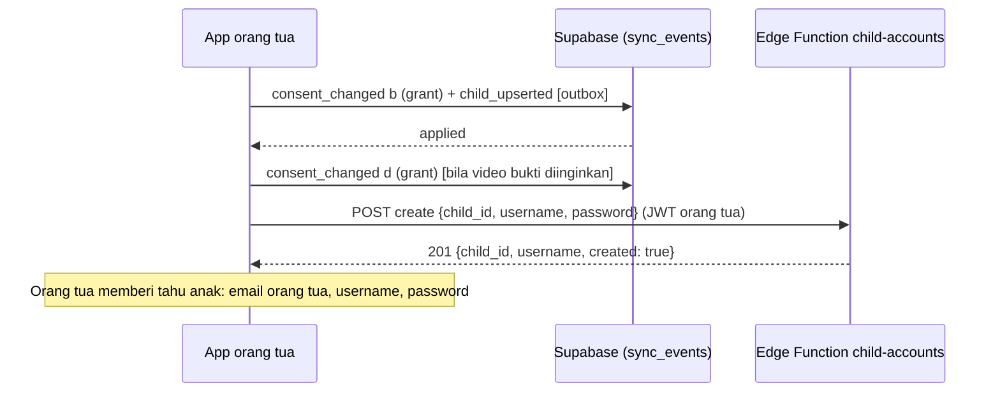
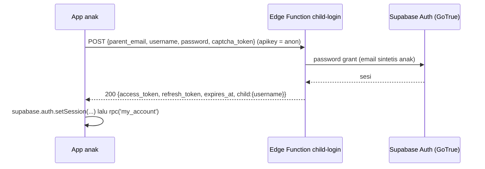
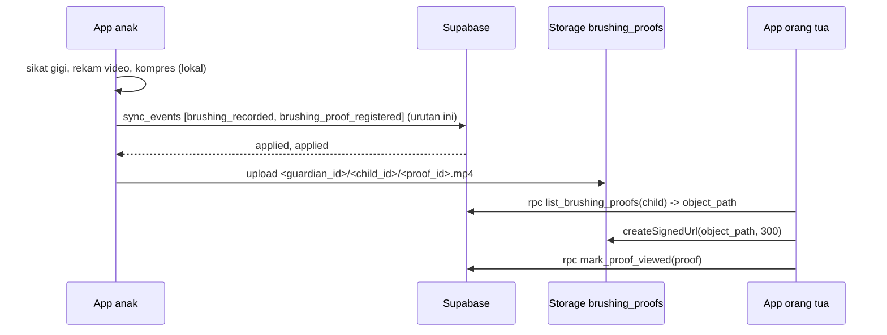
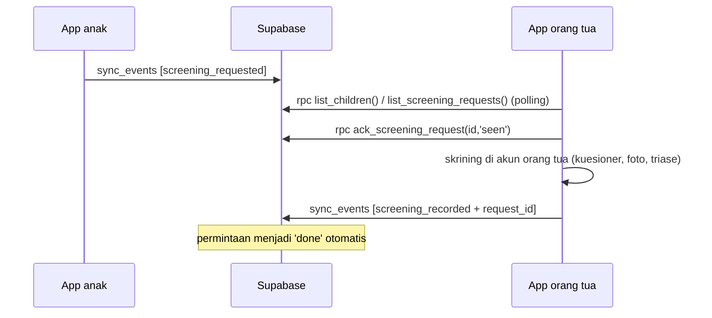

# Akun, login anak, streak, bukti video, permintaan skrining, riwayat

> **Ringkasan (ID).** Ada tiga jenis akun: **orang tua** (`guardian`), **remaja** (`teen`, untuk dirinya sendiri), dan **akun anak** (`child`, dibuat oleh orang tua). Anak masuk dengan **email orang tua + username anak + password anak** lewat Edge Function `child-login`, lalu memakai sesi Supabase biasa; hak anak dibatasi di database (RLS), bukan di app. Anak hanya bisa: mencatat sikat gigi (streak), merekam video bukti sikat gigi, dan **meminta skrining** ke orang tua. **Skrining dilakukan oleh akun orang tua/remaja.** Orang tua menonton bukti, menandai permintaan, dan melihat riwayat.
> **Kader (amandemen 2026-10-18):** kader **tidak** membuat akun anak. Fitur video bukti juga tersedia untuk kader sebagai riwayat atas murid yang ia miliki (bagian 2.8).
> Keputusan dan alasan: [ADR 017](../../../docs/decisions/017-account-model-v2.md). Dokumen ini: alur lengkap, kontrak panggilan, tabel hak, galat, dan daftar periksa UI. Pelengkap: [`SYNC_EVENTS.md`](SYNC_EVENTS.md) (tipe event baru), [`SUPABASE_API.md`](SUPABASE_API.md) (RPC, Storage), [`EDGE_FUNCTIONS_AND_HOOKS.md`](EDGE_FUNCTIONS_AND_HOOKS.md) (`child-accounts`, `child-login`).
> Status verifikasi (2026-10-18): skema, RLS, RPC, dan event diuji pgTAP pada Postgres 17 tanpa Docker (501 asersi, 18 berkas, migrasi dijalankan dua kali); Edge Function diuji Deno dengan klien tiruan (122 uji). `supabase test db` kanonik belum dijalankan (Docker mati). **Belum dijalankan terhadap proyek dev yang hidup** dan belum e2e dari HP (`[PERLU VERIFIKASI]`, lihat bagian 11).

## 1. Tiga jenis akun

| | `guardian` (orang tua) | `teen` (remaja) | `child` (akun anak) |
|---|---|---|---|
| Dibuat oleh | mendaftar sendiri | mendaftar sendiri | **hanya orang tua** (Edge Function `child-accounts`) |
| Login dengan | email + password | email + password | email **orang tua** + username + password anak (`child-login`) |
| Punya anak | banyak (maks. `max_child_accounts_per_guardian`, bawaan 6 akun anak) | satu profil diri (`is_self`) | profil dirinya saja, hanya dibaca |
| Skrining, rujukan, consent | ya | ya (untuk dirinya) | **tidak** |
| Catat sikat gigi (streak) | ya | ya | ya (miliknya) |
| Kirim permintaan skrining | tidak (menerima) | tidak | **ya** |
| Rekam/unggah video bukti | tidak | tidak | **ya** (butuh consent `d`) |
| Tonton / hapus bukti | ya | ya | **tidak** (tidak bisa membaca ulang) |
| Kelola akun anak | ya | tidak | tidak |
| Hapus data / akun | ya | ya | **tidak** |

**Kader** adalah peran tambahan pada akun bertipe `guardian` (diberikan admin, bukan dipilih saat daftar). Kader tidak membuat akun anak, tetapi dapat merekam dan melihat video bukti murid miliknya (bagian 2.8).

Pilihan `guardian` / `teen` dibuat saat `signUp`; app membaca jenis akun dari `my_account()` (bagian 3), jangan menyimpulkannya dari tebakan di sisi klien.

## 2. Alur

### 2.1 Daftar: untuk diri sendiri (remaja) atau orang tua

```ts
// Layar pilih peran: "Untuk saya sendiri (remaja)" -> 'teen'; "Saya orang tua" -> 'guardian'
const { error } = await supabase.auth.signUp({
  email,
  password,                                  // >= 8, huruf kecil + besar + angka
  options: {
    data: { account_type: 'teen' },          // atau 'guardian'
    captchaToken,                            // Turnstile (SUPABASE_API.md 1.3)
    emailRedirectTo: 'https://app.ryhnfir.dev/auth/callback',
  },
});
```

- Nilai selain `'teen'` / `'guardian'` (termasuk `'child'`) diabaikan server dan dianggap `guardian`. Jenis akun **bukan** batas keamanan: kedua jenis punya hak yang sama atas data miliknya sendiri. Akun anak tidak bisa dibuat dari `signUp`.
- Email harus dikonfirmasi; sesi baru ada setelah tautan dibuka (lihat `APP_TEAM_GUIDE.md` §4).
- **Remaja** langsung setelah masuk pertama kali membuat profil dirinya (sekali; aman diulang):

```ts
const selfId = crypto.randomUUID();                       // dibuat di perangkat
const { data: childId, error } = await supabase.rpc('ensure_self_profile', {
  p_child_id: selfId, p_birth_year: 2012, p_birth_month: 5,   // bulan opsional
});
// Selalu pakai childId yang dikembalikan (jika profil sudah ada, itu id yang lama).
```

  Rentang usia remaja: `limits.teen_min_age`..`teen_max_age` (bawaan 10..19) dihitung dari tahun-bulan lahir; tanpa bulan, semua usia yang mungkin harus masuk rentang. Di luar itu → galat `age_out_of_range`. Lalu kirim `consent_changed` (`b`, lalu `a`/`c` bila perlu) seperti biasa. Remaja **tidak** bisa membuat profil anak lain.
- **Orang tua** menambah anak seperti sebelumnya: event `consent_changed` (grant `b`) membuat profil kosong, lalu `child_upserted` (tahun-bulan lahir; tanpa nama).

### 2.2 Orang tua mendaftarkan akun untuk anak



```ts
const res = await fetch(`${SUPABASE_URL}/functions/v1/child-accounts`, {
  method: 'POST',
  headers: {
    'Content-Type': 'application/json',
    apikey: SUPABASE_ANON_KEY,
    Authorization: `Bearer ${session.access_token}`,       // JWT orang tua
  },
  body: JSON.stringify({ action: 'create', child_id, username: 'si.budi', password }),
});
```

- **Password anak dibuat orang tua** untuk anak itu; **bukan** password akun orang tua (ADR 017 §2.2). Sarankan frasa mudah diingat anak (kelas 4 SD) yang memenuhi kebijakan: ≥ 8 karakter, huruf kecil + besar + angka, maks. 72 byte, tanpa karakter kontrol.
- **Username** = nama panggilan, huruf kecil `a-z 0-9 . _ -`, 3–20 karakter, harus diawali huruf/angka, unik per orang tua. Server memangkas spasi dan menjadikannya huruf kecil; kata terlarang (`admin`, `root`, `system`, `null`, …) ditolak. **UI wajib mengingatkan: pakai nama panggilan, jangan nama asli** (server tidak bisa memeriksa).
- Prasyarat: profil anak sudah ada **di server** (event `child_upserted`/`consent_changed` berstatus `applied`) dan milik orang tua itu. Tunggu hasil sinkron sebelum memanggil `create`.
- Aksi lain (`POST` ke fungsi yang sama): `reset_password {child_id, password}`, `set_disabled {child_id, disabled}`, `delete {child_id}`. `set_disabled` berlaku **segera** (akses anak langsung ditolak RLS dan sesi Auth diblokir); `delete` menghapus akun masuk anak, profil dan datanya tetap (untuk menghapus data: `request_deletion`).
- Galat (`{ "error": "<kode>" }`):

| HTTP | `error` | Arti / tindakan UI |
|---|---|---|
| 400 | `invalid_body` | `action`/`child_id` salah atau body > 4 KiB: bug klien |
| 401 | `unauthorized` | JWT hilang/kedaluwarsa: refresh sesi / masuk ulang |
| 403 | `forbidden` | pemanggil remaja, akun anak, atau **kader** (kader tidak membuat/mengelola akun anak) |
| 404 | `child_not_found` | anak bukan milik pemanggil **atau** belum ada di server (sama persis) → pastikan sinkron `applied`; atau `reset_password` untuk anak yang belum punya akun |
| 409 | `child_already_has_account` | tampilkan "akun anak sudah ada" (ubah lewat reset/nonaktifkan) |
| 409 | `child_account_limit` | batas `max_child_accounts_per_guardian` tercapai |
| 409 | `username_taken` | username sudah dipakai orang tua ini → minta nama lain. **Catatan:** penolakan lain dari pemicu server (mis. permintaan hapus sedang berjalan) saat ini juga tampil sebagai `username_taken` (lihat bagian 11) |
| 422 | `invalid_username` / `weak_password` | tampilkan aturan di formulir (cek lokal dulu agar tidak bolak-balik) |
| 405 / 500 | `method_not_allowed` / `internal` | coba lagi nanti |

Fungsi ini tidak pernah mengembalikan password, email sintetis, atau id akun Auth anak.

### 2.3 Anak masuk



```ts
const r = await fetch(`${SUPABASE_URL}/functions/v1/child-login`, {
  method: 'POST',
  headers: { 'Content-Type': 'application/json', apikey: SUPABASE_ANON_KEY, Authorization: `Bearer ${SUPABASE_ANON_KEY}` },
  body: JSON.stringify({ parent_email, username, password, captcha_token }),
});
if (r.ok) {
  const s = await r.json();
  await supabase.auth.setSession({ access_token: s.access_token, refresh_token: s.refresh_token });
  const { data: me } = await supabase.rpc('my_account');   // account_type === 'child'
}
```

| HTTP | `error` | UI |
|---|---|---|
| 200 | — | masuk; simpan sesi di penyimpanan aman seperti sesi biasa (refresh token jalan normal) |
| 401 | `invalid_credentials` | **satu pesan untuk semua sebab** (email orang tua tak dikenal, username/password salah, akun dinonaktifkan, CAPTCHA ditolak). Tulis: "Email orang tua, nama, atau kata sandi salah." Jangan membedakan |
| 429 | `too_many_attempts` | terlalu banyak percobaan (bawaan 8 per 15 menit per kombinasi email orang tua + jaringan). Hormati header `Retry-After` (detik) dan tampilkan "Coba lagi nanti, atau minta bantuan orang tua" |
| 400 | `invalid_body` | bidang kosong/terlalu panjang: validasi di formulir |
| 502 | `upstream_unavailable` | layanan masuk sedang sibuk: coba lagi, tidak dihitung sebagai percobaan |
| 500 / 405 | `internal` / `method_not_allowed` | bug/konfigurasi |

- Layar login anak memuat **CAPTCHA Turnstile** yang sama dengan login biasa; token dikirim sebagai `captcha_token` dan diteruskan ke Auth.
- Anak **tidak punya** "lupa password" atau ganti password; ia meminta orang tua (`reset_password`). Layar login anak sebaiknya menyimpan email orang tua (bukan password) agar anak hanya mengetik username dan password.
- Setelah masuk, **semua** panggilan memakai klien `supabase` biasa; yang boleh dilakukan akun anak ditegakkan RLS. Jika orang tua menonaktifkan akun, RPC/tulis anak mulai gagal (`forbidden` / RLS) dan refresh token gagal → kembalikan ke layar login.
- `my_account().child_account` memuat `sync_allowed` dan `proof_allowed`; pakai untuk menyembunyikan tombol (bagian 3).

### 2.4 Anak: streak sikat gigi + video bukti



1. Anak menyikat gigi; app mencatat durasi. Catat `brushing_recorded` seperti sebelumnya ([`SYNC_EVENTS.md`](SYNC_EVENTS.md) §3.4). Sebuah hari **terhitung untuk streak** bila ada ≥ 1 sesi dengan `duration_s ≥ streak_min_duration_s` (bawaan 60 detik).
2. **Video bukti hanya bila** `my_account().child_account.proof_allowed === true` (flag `brushing_proof_video` hidup **dan** consent `b` + `d` aktif **dan** akun tidak dinonaktifkan). Rekam lewat kamera, lalu **kompres di perangkat** sebelum apa pun dikirim: ≈ 480p, bitrate rendah, ≤ `proof_max_duration_s` (180 detik), ≤ `proof_max_bytes` (10 MiB), format MP4 (`video/mp4`) atau `video/quicktime`. Batas Free 1 GB Storage membuat ukuran klip penting (ADR 017 §2.5).
3. Kirim `brushing_proof_registered` (di batch yang sama **setelah** `brushing_recorded`, atau di batch berikutnya setelah `applied`):

```json
{ "event_id": "…", "type": "brushing_proof_registered",
  "payload": { "proof_id": "<uuid baru>", "child_id": "<uuid anak>",
               "brushing_event_id": "<brushing_id event tadi>",
               "size_bytes": 3400000, "duration_s": 120, "mime": "video/mp4" } }
```

4. Setelah `applied`, **baru unggah** ke path yang dibentuk server: `<guardian_id>/<child_id>/<proof_id>.mp4` (`.mov` untuk `video/quicktime`). `guardian_id` ada di `my_account().child_account.guardian_id`; huruf kecil semua. Kebijakan Storage hanya menerima path yang persis terdaftar, ukuran dan tipe sesuai, oleh akun anak itu sendiri.

```ts
const path = `${me.child_account.guardian_id}/${childId}/${proofId}.mp4`;
const { error } = await supabase.storage.from('brushing_proofs')
  .upload(path, arrayBuffer, { contentType: 'video/mp4', upsert: false });   // jangan upsert
```

   Di React Native gunakan `ArrayBuffer`/`Blob` dari berkas lokal (mis. `expo-file-system` + dekode base64); jangan memuat video besar sekaligus di JS jika bisa dihindari. Antrekan unggahan: bila gagal jaringan, ulangi dengan path yang sama; bila metadata sudah `applied` tetapi berkas tak kunjung masuk, baris bukti tetap ada sampai kedaluwarsa.
5. Retensi: video dihapus otomatis `proof_retention_days` (bawaan **7 hari**) setelah didaftarkan; orang tua dapat menghapus kapan saja; menarik consent `d` menyembunyikan bukti seketika dan menghapus berkas ≤ 24 jam. Video **tidak** dipakai untuk melatih model dan tidak dilihat siapa pun selain orang tua anak itu.
6. Akun anak **tidak** bisa membaca ulang video (tidak ada kebijakan baca Storage untuknya); simpan salinan lokal sendiri bila perlu, lalu hapus dari perangkat setelah terunggah.

Penolakan khusus (hasil `sync_events`, final):

| `code` | Arti |
|---|---|
| `forbidden` | bukan akun anak, bukan anaknya, atau akun dinonaktifkan |
| `deletion_pending` | ada permintaan hapus untuk anak/akun orang tua |
| `feature_disabled` | flag `brushing_proof_video` mati |
| `consent_required` | consent `b` **atau** `d` belum aktif (minta orang tua memberikan consent `d`) |
| `limit_exceeded` | ukuran/durasi melewati batas, atau sudah `proof_max_per_child_per_day` (3) klip hari ini (hari WIB) |
| `schema_invalid` | `brushing_event_id` belum ada (kirim `brushing_recorded` dulu), mime/angka salah, kunci tak dikenal |

### 2.5 Anak meminta skrining; orang tua melakukan skrining



- Anak (hanya akun anak) mengirim `screening_requested` lewat outbox:

```json
{ "event_id": "…", "type": "screening_requested",
  "payload": { "request_id": "<uuid baru>", "child_id": "<uuid anak>",
               "reason_code": "toothache", "pain_level": 6 } }
```

  `reason_code` ∈ `toothache | sensitive_teeth | bleeding_gums | swelling | other` (kode, **tanpa teks bebas**); `pain_level` 0–10 atau tiada. UI anak: pilihan bergambar dan skala nyeri sederhana. Batas `request_max_per_child_per_day` (5/hari WIB) → `limit_exceeded`. Syarat: consent `b` aktif, bukan penghapusan berjalan.
- **Red flag tetap menang di sisi app.** Untuk `swelling` (dan bila anak menyebut demam/nanah/benturan di kuesioner lokal), layar anak menampilkan anjuran segera memberi tahu orang tua/ke faskes **secara lokal**. Server tidak menurunkan atau menaikkan level apa pun dari permintaan.
- Orang tua mengambil permintaan (lihat bagian 4): `list_children().unseen_requests` untuk lencana, `list_screening_requests` untuk daftar. **Tidak ada push/Realtime** di MVP: lakukan polling saat layar beranda orang tua aktif/foreground (anjuran: saat dibuka, dan tiap 60 detik selagi tampil).
- `ack_screening_request(p_id, 'seen' | 'cancel')`: `seen` saat orang tua membuka; `cancel` bila tidak perlu. Permintaan yang lewat `request_expiry_days` (14 hari) menjadi `expired`.
- **Skrining dilakukan oleh akun orang tua** memakai alur yang sudah ada. Saat mencatat hasil, sertakan `request_id` (opsional, aditif) pada `screening_recorded`; bila permintaan masih `pending`/`seen` dan belum kedaluwarsa, ia otomatis menjadi `done` dan menaut ke `screening_id`. `request_id` dari anak lain → `forbidden`.
- Hasil skrining **tidak** terlihat oleh akun anak (tidak ada akses ke `screening`); orang tua yang menyampaikannya.

### 2.6 Orang tua menonton bukti

```ts
const { data: proofs } = await supabase.rpc('list_brushing_proofs', { p_child: childId, p_limit: 20 });
// -> [{ id, child_id, brushing_event_id, object_path, mime, size_bytes, duration_s,
//       status, uploaded_at, expires_at, viewed_at, object_present }]
const p = proofs[0];
if (p.object_present) {
  const { data } = await supabase.storage.from('brushing_proofs').createSignedUrl(p.object_path, 300);
  // putar data.signedUrl di pemutar video; jangan simpan/bagikan URL
  await supabase.rpc('mark_proof_viewed', { p_proof: p.id });
}
await supabase.rpc('delete_brushing_proof', { p_proof: p.id });   // sembunyikan seketika
```

- `object_present = false`: pendaftaran sudah masuk tetapi berkas belum tiba (anak belum selesai mengunggah); tampilkan "belum selesai diunggah".
- Hanya klip hidup yang dikembalikan (`uploaded`/`viewed`, belum kedaluwarsa, belum dihapus, consent `d` aktif). Tampilkan sisa waktu dari `expires_at` ("dihapus otomatis dalam N hari") dan tombol Hapus.
- URL bertanda tangan: ≤ 300 detik; buat baru tiap memutar. Video hanya untuk pemilik anak (orang tua/remaja, atau kader untuk murid yang ia miliki, bagian 2.8); fasilitas kesehatan dan admin tidak punya akses.

### 2.7 Riwayat dan streak

```ts
// Linimasa gabungan, terbaru dulu, paginasi keyset
const { data } = await supabase.rpc('child_history', {
  p_child: childId, p_limit: 30,
  p_kinds: ['screening', 'brushing'],        // opsional; null = semua jenis yang boleh
  p_before: null, p_from: null,              // p_before = next_before halaman sebelumnya
});
// data = { items: [{ kind, id, occurred_at, data }], next_before: timestamptz | null }

const { data: streak } = await supabase.rpc('brushing_streak', { p_child: childId, p_tz: 'Asia/Jakarta' });
// { current, longest, last_day, today_done, week:[{date,done,brushings}]*7, min_duration_s, tz }
```

| `kind` | `data` | Terlihat oleh |
|---|---|---|
| `screening` | `level, red_flag, model_version, rules_version, findings_count, request_id` | orang tua/remaja, kader (roster) |
| `brushing` | `duration_s, spirit_score, slot, camera_mode, counts_for_streak, has_proof` | semua, termasuk anak |
| `referral` | `level, reason_codes, facility_code, screening_id` | orang tua/remaja, kader |
| `screening_request` | `reason_code, pain_level, status, seen_at, responded_at, screening_id, expires_at` | orang tua/remaja, anak (miliknya) |
| `brushing_proof` | `brushing_event_id, status, mime, size_bytes, duration_s, viewed_at, expires_at` | orang tua/remaja, anak (metadata saja) |

- Paginasi: urut waktu menurun; ulangi dengan `p_before = next_before` sampai `null`. Halaman tidak memotong item dengan cap waktu sama sehingga bisa memuat sedikit lebih dari `p_limit` (maks. 100). `p_kinds` tidak valid → `invalid_kind`.
- `data` hanya berisi kode/angka/id: **tanpa** username, path/URL Storage, teks bebas. Skrining untuk akun anak tidak pernah muncul (ia tidak boleh melihatnya).
- `status` permintaan pada riwayat sudah efektif (pending/seen yang lewat waktu = `expired`).
- **Streak**: dihitung server per hari kalender zona `p_tz` (nama zona IANA; salah → `invalid_timezone`). `current` = hari berturut-turut sampai hari ini, atau sampai kemarin bila hari ini belum terhitung (`today_done=false`) — tampilkan "sikat gigi hari ini supaya streak tidak putus". Untuk mode offline, app tetap boleh menghitung streak lokal; angka server menjadi acuan setelah sinkron.

### 2.8 Kader: video bukti sebagai riwayat (amandemen 2026-10-18)

Kader (peran `kader` pada akun bertipe `guardian`) **tidak membuat dan tidak mengelola akun anak** (`child-accounts` dan database menolaknya). Murid kader adalah profil anak yang **dimiliki kader sendiri** (roster), jadi tidak ada akun login anak untuk mereka. Fitur video tersedia bagi kader sebagai riwayat:

1. Persetujuan: consent `b` dan `d` untuk murid itu. Bila orang tua memberi izin di atas kertas, kader mencatatnya dengan `consent_changed` `method: "paper_via_kader"` (lihat [`SYNC_EVENTS.md`](SYNC_EVENTS.md) §3.1). Tanpa `d`: `consent_required`.
2. Kader merekam sesi sikat gigi murid dari **akun kader sendiri**, mengompres klip (aturan sama dengan bagian 2.4), lalu mengirim `brushing_recorded` + `brushing_proof_registered` (`child_id` = murid milik kader) dan mengunggah ke `<kader_id>/<child_id>/<proof_id>.mp4` setelah `applied`. Kader hanya bisa mendaftarkan bukti untuk anak yang **ia miliki**; anak orang lain atau anak yang dimiliki orang tua -> `forbidden`.
3. Riwayat: `child_history` (jenis `brushing_proof` dan `brushing`), `list_brushing_proofs`, `createSignedUrl`, `mark_proof_viewed`, `delete_brushing_proof` bekerja untuk kader pada anak miliknya persis seperti untuk orang tua (bagian 2.6, 2.7). `list_children().unviewed_proofs` memberi lencana.
4. Batas, retensi 7 hari, penghapusan otomatis, dan penghapusan oleh pemilik **sama persis**. Fasilitas kesehatan (`facility_viewer`) dan admin tetap tidak punya akses ke video.
5. UI: tampilkan fitur ini hanya bila `my_account().capabilities.register_proofs` bernilai `true`; sembunyikan "Buat akun anak" bila `capabilities.create_child_accounts` bernilai `false`.

## 3. `my_account()` — satu panggilan untuk routing app

```json
{ "user_id": "…", "account_type": "guardian|teen|child", "roles": ["guardian"],
  "self_child_id": "…|null", "child_accounts": 2,
  "child_account": { "child_id": "…", "guardian_id": "…", "username": "si.budi",
                    "disabled": false, "sync_allowed": true, "proof_allowed": true },
  "flags": { "brushing_proof_video": true },
  "capabilities": { "create_child_accounts": true, "register_proofs": false },
  "limits": { "teen_min_age": 10, "teen_max_age": 19, "max_child_accounts_per_guardian": 6,
              "streak_min_duration_s": 60, "request_max_per_child_per_day": 5, "request_expiry_days": 14,
              "proof_max_bytes": 10485760, "proof_max_duration_s": 180,
              "proof_max_per_child_per_day": 3, "proof_retention_days": 7 } }
```

`child_account` hanya ada untuk akun anak; `self_child_id` dan `child_accounts` untuk orang tua/remaja. Baca batas dari `limits` (bisa diubah server tanpa rilis app) — jangan menanam angka. Rute: `child` → beranda anak (streak, minta skrining); `teen` → beranda remaja (alur orang tua untuk diri sendiri, tanpa "tambah anak"); `guardian` → beranda orang tua.

## 4. Beranda orang tua: `list_children()`

Satu baris per anak milik pemanggil (remaja: profil dirinya): `child_id, is_self, birth_year, birth_month, consents[], has_child_account, child_account_disabled, username, last_screening_at, last_screening_level, last_brushing_at, open_requests, unseen_requests, unviewed_proofs, deletion_pending`. Pakai `unseen_requests` dan `unviewed_proofs` untuk lencana. Akun anak memanggilnya → `forbidden`. `username` hanya untuk ditampilkan kepada orang tua pemiliknya.

`list_screening_requests({ p_child?, p_status?, p_limit })` mengembalikan permintaan (status efektif; `p_status` array dari `pending|seen|done|cancelled|expired`). Orang tua: semua anaknya atau satu anak; akun anak: miliknya saja.

## 5. Consent (tambahan: jenis `d`)

| Jenis | Arti | Dipakai untuk |
|---|---|---|
| `a` | simpan lokal | (tidak berubah) |
| `b` | kirim data teknis terpseudonim | semua sinkron data, **termasuk** event akun anak |
| `c` | unggah foto dataset | (tidak berubah; flag mati) |
| **`d`** | **bukti sikat gigi video ke orang tua** | `brushing_proof_registered` + berkas video |

`d` diberikan **orang tua** (bukan anak) lewat `consent_changed` dengan `text_version` teks persetujuan; dapat ditarik kapan saja (bukti langsung disembunyikan, berkas dihapus ≤ 24 jam). Teks persetujuan `d` harus menyebut: video mulut/wajah anak direkam, hanya dilihat orang tua, dihapus otomatis ≤ 7 hari. **Isi final menunggu tinjauan hukum** (bagian 11).

## 6. Hak akses ringkas (RLS = sumber kebenaran)

| Data | Orang tua / remaja | Akun anak |
|---|---|---|
| `child_profile` | baca/tulis milik sendiri | baca baris anak itu saja |
| `consent` | baca/tulis untuk anaknya | tidak ada |
| `screening`, `referral`, `image_upload` | seperti sebelumnya | **tidak ada** |
| `brushing_event` | baca, catat | catat dan baca miliknya |
| `screening_request` | baca; ubah status lewat RPC | buat (via `sync_events`) dan baca miliknya |
| `brushing_proof` + Storage `brushing_proofs` | baca metadata, tandai dilihat, hapus, tonton lewat URL bertanda tangan (kader: juga mendaftar + mengunggah untuk murid miliknya) | daftar + unggah; tidak bisa membaca berkas |
| `child_account` | baca akun anaknya (tanpa kredensial) | baca barisnya sendiri |
| `request_deletion` | ya | **tidak** (`forbidden`) |
| `sync_events` | semua tipe lama | hanya `brushing_recorded`, `screening_requested`, `brushing_proof_registered` untuk anak itu sendiri |

Akun anak yang dinonaktifkan kehilangan seluruh akses seketika; sinkron anak juga berhenti bila ada permintaan hapus untuk anak itu atau akun orang tuanya. Semua RPC riwayat/orang tua menjawab **sama** (`42501 forbidden`) untuk "bukan milik Anda" dan "tidak ada": jangan membedakannya di UI.

## 7. Kode galat RPC

Galat RPC datang sebagai respons PostgREST dengan `code` = SQLSTATE dan `message` = kode tetap (tanpa nilai data).

| `message` | SQLSTATE | Arti |
|---|---|---|
| `not_authenticated` | 28000 | tidak ada sesi |
| `forbidden` | 42501 | bukan hak Anda / tidak ada / akun anak memanggil RPC orang tua |
| `invalid_argument` | 22023 | parameter salah |
| `age_out_of_range` | 22023 | `ensure_self_profile`: usia di luar rentang remaja |
| `deletion_pending` | 22023 | ada permintaan hapus untuk profil/akun |
| `invalid_kind` | 22023 | `child_history`: `p_kinds` memuat jenis tak dikenal/kosong |
| `invalid_action` | 22023 | `ack_screening_request`: bukan `seen`/`cancel` |
| `invalid_timezone` | 22023 | `brushing_streak`: zona IANA tidak dikenal |

## 8. Tipe event baru di `sync_events`

Ringkas (rinci di [`SYNC_EVENTS.md`](SYNC_EVENTS.md) §3.7–3.8): `screening_requested` (hanya akun anak) dan `brushing_proof_registered` (akun anak, atau kader pemilik anak); `screening_recorded` menerima `request_id` opsional; `consent_changed` menerima jenis `d`; kode penolakan baru `limit_exceeded`. Akun anak yang mengirim tipe lain → `forbidden`; orang tua/remaja yang mengirim kedua tipe baru, atau kader yang mengirim `screening_requested` → `forbidden`. Urutan gerbang: `forbidden` → `deletion_pending` → `feature_disabled` (video) → `consent_required` → `limit_exceeded` → `schema_invalid`.

## 9. Penghapusan dan pembersihan otomatis

- `request_deletion` anak → akun masuk anak, bukti video (berkas + baris), dan permintaan skrining ikut terhapus bersama data lain.
- `request_deletion` akun orang tua → semua anak, akun anak, dan bukti ikut terhapus; sesi anak berhenti sinkron seketika.
- Harian: permintaan kedaluwarsa, bukti kedaluwarsa/dihapus/consent-ditarik dibersihkan (berkas lalu baris), catatan percobaan login lama dibuang.
- Hak hapus bukan fungsi akun anak: anak meminta orang tua.

## 10. Daftar periksa UI

**Daftar / masuk**
- [ ] Layar pilih peran saat daftar (remaja / orang tua); kirim `options.data.account_type`.
- [ ] Setelah masuk, `my_account()` menentukan beranda; sesi akun anak dibersihkan saat keluar.
- [ ] Remaja: `ensure_self_profile` sekali; tidak ada menu "tambah anak".
- [ ] Layar login anak: email orang tua (diingat), username, password, Turnstile; satu pesan galat seragam; tangani 429 dengan `Retry-After`.

**Orang tua**
- [ ] Tambah anak → minta consent `b` (dan `d` bila video) → sinkron → "Buat akun anak" (username nama panggilan, password dengan aturan, peringatan "jangan nama asli").
- [ ] Kelola akun anak: reset password, nonaktifkan/aktifkan, hapus (konfirmasi sebelum hapus).
- [ ] Lencana permintaan baru dan bukti belum ditonton (`list_children`), polling saat foreground.
- [ ] Daftar permintaan → tandai dilihat/batal → skrining → `screening_recorded` dengan `request_id`.
- [ ] Pemutar bukti (URL ≤ 300 detik), sisa waktu retensi, hapus; teks consent `d`.
- [ ] Riwayat per anak (`child_history`) dan streak (`brushing_streak`).

**Kader**
- [ ] Tidak ada menu "Buat akun anak" (`capabilities.create_child_accounts === false`).
- [ ] Rekam + kompres + unggah video murid hanya bila `capabilities.register_proofs`; consent `b` + `d` per murid (kertas: `paper_via_kader`).
- [ ] Riwayat murid: `child_history`, pemutar bukti, hapus; lencana `unviewed_proofs`.

**Anak (kelas 4 SD, kosakata sederhana)**
- [ ] Beranda hanya: streak, mulai sikat gigi, "Gigiku sakit" (minta periksa). Tidak ada hasil skrining, foto, rujukan, pengaturan akun, atau hapus.
- [ ] Rekam video bukti hanya bila `proof_allowed`; kompres; tampilkan kemajuan unggah; batasi sesuai `limits`.
- [ ] Nyeri hebat/bengkak: tampilkan anjuran lokal "beri tahu orang tua sekarang"; red flag tidak menunggu server.
- [ ] Bila `sync_allowed=false`: tampilkan "Minta orang tua mengaktifkan"; jangan menumpuk outbox tanpa batas.

## 11. Risiko, batas, dan yang belum diverifikasi

| Butir | Catatan / tindakan |
|---|---|
| Kuota Storage Free 1 GB | ≈ 3 klip × 4 MB × 7 hari ≈ 84 MB per anak → ±12 anak memenuhi kuota. Kompresi klien wajib; `quota-check` memantau. Turunkan `proof_retention_days`/`proof_max_per_child_per_day` atau naik paket bila perlu |
| Batas laju Auth bersama | Login anak lewat Edge Function sehingga batas `sign_in_sign_ups` per-IP berlaku untuk IP fungsi (bersama semua anak). Cukup untuk MVP; dicatat sebagai risiko |
| Username berisi nama asli | Tidak dapat dicegah server; UI harus mengingatkan |
| `username_taken` ambigu | Penolakan pemicu (mis. permintaan hapus berjalan) kini juga muncul sebagai `username_taken`; perbaikan (pra-cek RPC / kode khusus) dijadwalkan |
| Alamat IP untuk throttle | Dibaca dari `cf-connecting-ip`, lalu hop pertama `x-forwarded-for`; apakah Supabase meneruskan header itu **belum diverifikasi** |
| OPTIONS/CORS web | Apakah preflight lolos dengan `verify_jwt=true` belum diverifikasi (hanya berpengaruh pada web) |
| Belum dijalankan live | Migrasi `20261017*`, kedua Edge Function, dan Storage belum di-push ke proyek dev; belum ada uji HTTP e2e dan uji di HP. Jangan mengandalkan perilaku nyata sebelum backend memberi tahu "dev sudah di-deploy" |
| Kader dan akun anak | Diblokir di dua lapis: `child-accounts` menjawab 403 untuk kader, dan database menolak membuat akun anak bagi pemilik berperan `kader` (`child_account_invalid`). Akun anak yang sudah ada sebelum seseorang menjadi kader tidak dihapus otomatis |
| Kader melihat video murid | Dari keputusan pemilik produk 2026-10-18 (membalik janji "tidak dibagikan ke kader" di draf consent). Teks consent `d` dan pemberitahuan privasi harus menyebut kader; persetujuan kertas orang tua dan kedudukan sekolah/UKS sebagai pengendali data: `OPEN_LEGAL_QUESTIONS.md` Q-19 |
| Realtime/push | Tidak ada; polling |
| Hukum ⚖ | UU PDP (data pribadi anak, video wajah/mulut), remaja < 18 th mendaftar sendiri, retensi 7 hari & lokasi Singapura, email sintetis `.invalid`/pemulihan akun: belum ditinjau — `docs/regulatory/OPEN_LEGAL_QUESTIONS.md`. Fitur video sebaiknya tetap di balik flag `brushing_proof_video` sampai ditinjau |
