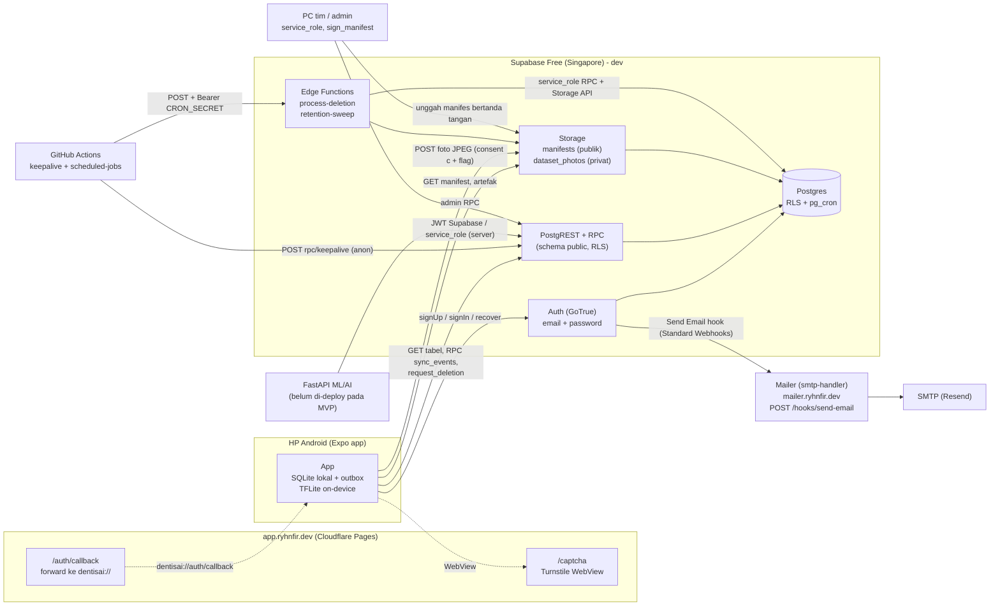

# DentisAI Backend API — Indeks

> **Ringkasan (ID).** Folder ini menjelaskan semua permukaan API backend DentisAI yang dipakai tim aplikasi (Expo/TypeScript): Supabase (Auth, PostgREST, RPC, Storage), Edge Functions, hook email, dan kontrak artefak (aturan triase, rekomendasi, model, manifes). Semua isi diturunkan dari kode dan migrasi di repo ini; hal yang belum bisa dibuktikan dari kode ditandai `[PERLU VERIFIKASI]`. Ini skrining, bukan diagnosis: semua keluaran berbunyi "indikasi" / "perlu diperiksa".
> Status: lingkungan **dev saja** (belum ada produksi). Tanggal dokumen: 2026-10-11. Perubahan: [`CHANGELOG.md`](CHANGELOG.md).

## Dokumen

| Dokumen | Untuk siapa | Isi |
|---|---|---|
| [`SUPABASE_API.md`](SUPABASE_API.md) | engineer app | Auth, tabel + RLS, RPC, Storage, rate limit, contoh supabase-js dan curl |
| [`SYNC_EVENTS.md`](SYNC_EVENTS.md) | engineer app (outbox) | Kontrak `sync_events`: amplop, tipe event, validasi, idempotensi, retry |
| [`EDGE_FUNCTIONS_AND_HOOKS.md`](EDGE_FUNCTIONS_AND_HOOKS.md) | ops / backend | `process-deletion`, `retention-sweep`, workflow terjadwal, hook Send Email, mailer |
| [`CLIENT_CONTRACTS.md`](CLIENT_CONTRACTS.md) | engineer app | Triase, rekomendasi, `labels.json` v2, manifes bertanda tangan, quality gate |
| [`../../api/docs/API.md`](../../api/docs/API.md) | engineer app / ML | FastAPI `/v1/screening`, `/v1/ml/*` (ditulis engineer lain; **belum tentu ada saat dokumen ini dibuat** `[PERLU VERIFIKASI]`) |
| [`CHANGELOG.md`](CHANGELOG.md) | semua | Riwayat perubahan dokumen kontrak |

Sumber kebenaran kode: [`../../supabase/migrations/`](../../supabase/migrations/), [`../../supabase/config.toml`](../../supabase/config.toml), [`../../supabase/functions/`](../../supabase/functions/), [`../../supabase/README.md`](../../supabase/README.md). Repo saudara (hanya dibaca): `../../../smtp-handler/` (mailer).

## Arsitektur

Catatan: tidak ada jalur dari app ke FastAPI pada MVP; deteksi utama jalan on-device (offline-first). Backend FastAPI **tidak** menangani auth/CRUD.

## Permukaan per klien

| Klien | Permukaan yang dipakai | Kredensial |
|---|---|---|
| App (orang tua / kader) | Auth; PostgREST baca (`child_profile`, `consent`, `screening`, `referral`, `brushing_event`, `deletion_request`, `feature_flag`, `user_role`, `class_roster*` untuk kader); RPC `sync_events`, `request_deletion`; Storage `manifests` (baca publik) dan `dataset_photos` (hanya INSERT); halaman `web/` | anon key + JWT pengguna |
| App (anon, belum login) | Hanya Storage `manifests` publik dan Auth (signUp/signIn/recover); mode anak tanpa akun bersifat offline penuh | anon key |
| Dasbor fasilitas (`facility_viewer`) | RPC `facility_screening_summary` | JWT pengguna berperan `facility_viewer` |
| Admin | RPC `admin_*`, tabel `audit_log`, `app_setting`, `ml_*` (baca) | JWT pengguna berperan `admin` |
| Scheduler (GitHub Actions) | RPC `keepalive`; Edge Functions | anon key; `CRON_SECRET` |
| PC tim | `service_role` (ekspor dataset, unggah manifes, backup) | `service_role` **hanya di PC tim**, tidak pernah di app/CI publik |
| Supabase Auth | `POST /hooks/send-email` di mailer | rahasia Standard Webhooks |
| FastAPI | RPC `service_ml_audit`, tabel `ml_*` | lihat `../../api/docs/API.md` |

## Lingkungan

| Lingkungan | Status | Alamat |
|---|---|---|
| Lokal (`supabase start`) | tersedia | API `http://127.0.0.1:54321`, DB `54322`, Studio `54323`, Mailpit `54324` (email lokal masuk ke Mailpit; CAPTCHA mati) |
| Dev (Supabase Free, `ap-southeast-1`) | **satu-satunya lingkungan hosted** | `https://<project-ref>.supabase.co` |
| Produksi | **belum ada** (rencana: proyek Free kedua) | - |
| Mailer | `https://mailer.ryhnfir.dev` (hook aktif hanya setelah `config push` dengan `AUTH_SEND_EMAIL_HOOK_ENABLED=true`); status deploy `[PERLU VERIFIKASI]` | - |
| FastAPI | tidak di-deploy pada MVP (ADR 009) | lokal `uvicorn` |

Kunci yang boleh ada di app: URL proyek dan **anon key** saja. `service_role`, `CRON_SECRET`, rahasia hook, dan kunci penandatangan manifes tidak boleh ada di app.

## Model auth dan peran

- Auth: **email + password**, konfirmasi email wajib, tanpa SMS/anonymous/MFA. Token akses JWT 1 jam, refresh token berotasi.
- Setiap akun baru otomatis mendapat baris `guardian` dan peran `guardian` (trigger `private.handle_new_user`); metadata dari klien **diabaikan**, jadi klien tidak bisa meminta peran.
- Peran (`public.user_role`, enum `app_role`): `guardian` (orang tua), `kader` (kader/guru UKS), `facility_viewer` (agregat saja, wajib `facility_code`), `admin`. Peran selain `guardian` hanya diberikan lewat RPC `admin_grant_role` (diaudit) atau SQL oleh owner.
- Pemisahan tugas: akun yang memiliki data anak tidak dapat menjadi `facility_viewer`/`admin`; pemberian peran itu mencabut `guardian`/`kader`.
- RLS aktif **dan dipaksa** di semua tabel; default deny. `anon` tidak punya akses tabel apa pun (hanya `keepalive()`).
- Edge Functions: `verify_jwt = false`, auth dengan `Authorization: Bearer <CRON_SECRET>` (bukan `service_role`).
- Data anak pseudonim: UUID dari perangkat, tahun+bulan lahir, kode alergi; tanpa nama/NIK/foto di tabel.

## Bentuk galat umum

| Sumber | Bentuk | Catatan |
|---|---|---|
| PostgREST / RPC | `{"code":"42501","details":null,"hint":null,"message":"forbidden"}` | HTTP 400 (22xxx, P0001, 23514), 401/403 (42501), 409 (23505/23503), 404 (`PGRST202` fungsi tidak ditemukan). Pemetaan kode ke status mengikuti konvensi PostgREST `[PERLU VERIFIKASI per versi]`; yang diuji repo: akses ditolak = 401 atau 403, batch kosong = 400 |
| Hasil per event `sync_events` | `{"index":0,"event_id":"<uuid>","status":"rejected","code":"consent_required"}` | HTTP 200; tolak per event bersifat final (lihat `SYNC_EVENTS.md`) |
| GoTrue (Auth) | `{"code":422,"error_code":"weak_password","msg":"..."}` | nama `error_code` mengikuti dokumentasi Supabase Auth `[PERLU VERIFIKASI per versi]` |
| Storage | `{"statusCode":"403","error":"Unauthorized","message":"new row violates row-level security policy"}` | bentuk umum Storage API `[PERLU VERIFIKASI]` |
| Edge Functions | `{"error":"forbidden"}` | kode: `not_configured` 503, `method_not_allowed` 405, `forbidden` 403, `list_failed` 500, `image_purge_failed` 500 |
| Mailer hook | `{"error":{"http_code":401,"message":"Invalid webhook signature"}}` | sukses = `200 {}` |
| FastAPI | lihat `../../api/docs/API.md` | - |

Pesan galat dari database memakai **kode tetap** (mis. `forbidden`, `batch_size_out_of_range`) dan tidak pernah memuat nilai data; log tidak boleh memuat PII.

## Aturan produk yang berlaku di semua API

1. Skrining, bukan diagnosis: teks keluaran memakai "indikasi" / "perlu diperiksa" dan CTA rujukan. Daftar frasa terlarang: [`../style/forbidden_phrases.md`](../style/forbidden_phrases.md).
2. Red flag (dari kuesioner gejala) selalu mengalahkan logika lain.
3. Foto rongga mulut hanya diunggah bila consent (c) aktif **dan** flag `dataset_contribution` hidup (default mati sampai KEPK menyetujui).
4. Ukuran kotak deteksi tidak pernah dipakai untuk menilai keparahan (ADR 014).
5. Status klinis saat ini: draf, belum ditinjau drg; tidak boleh dipakai pada anak.
